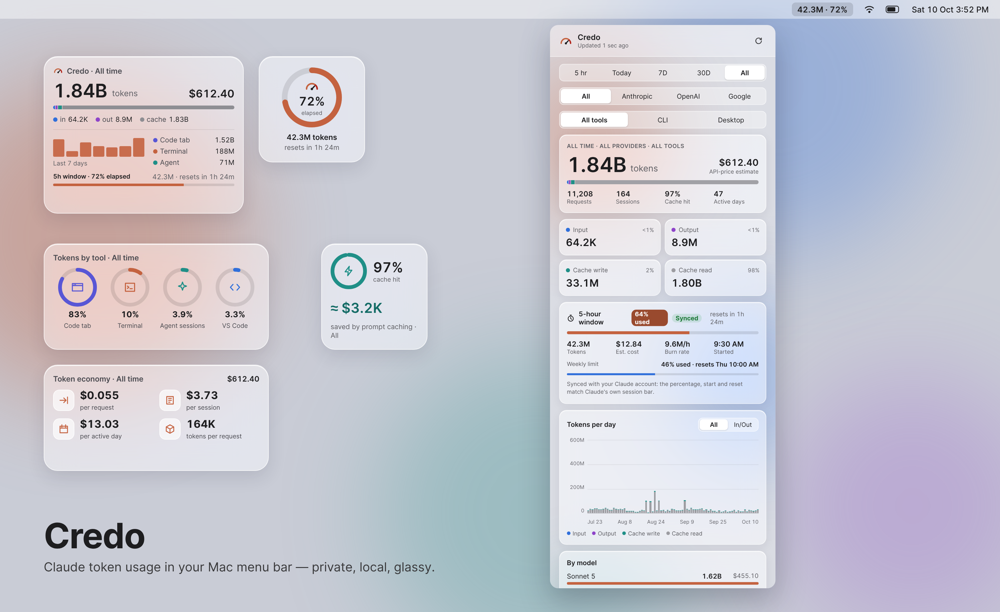
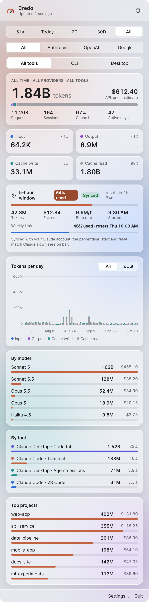
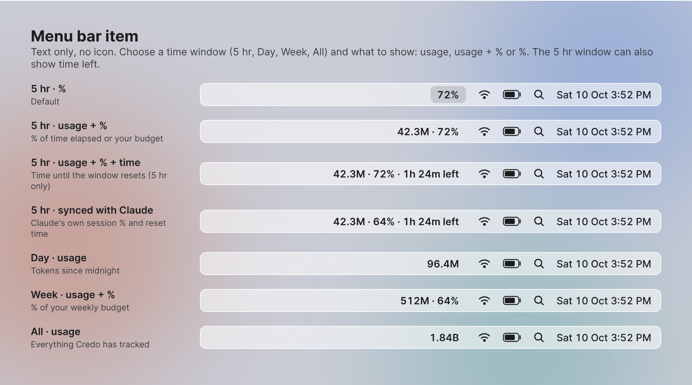
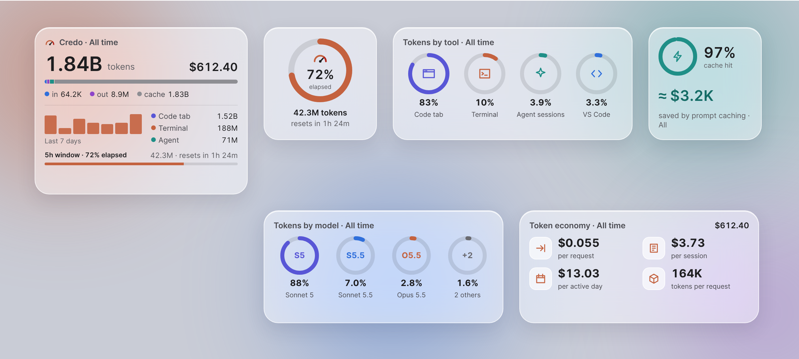
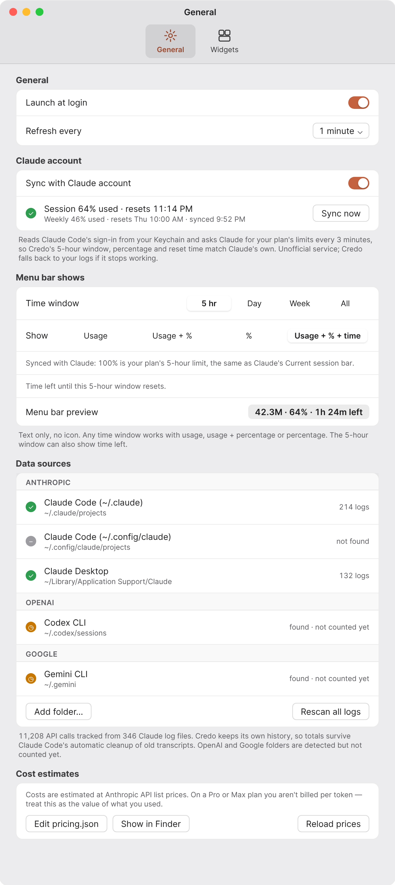
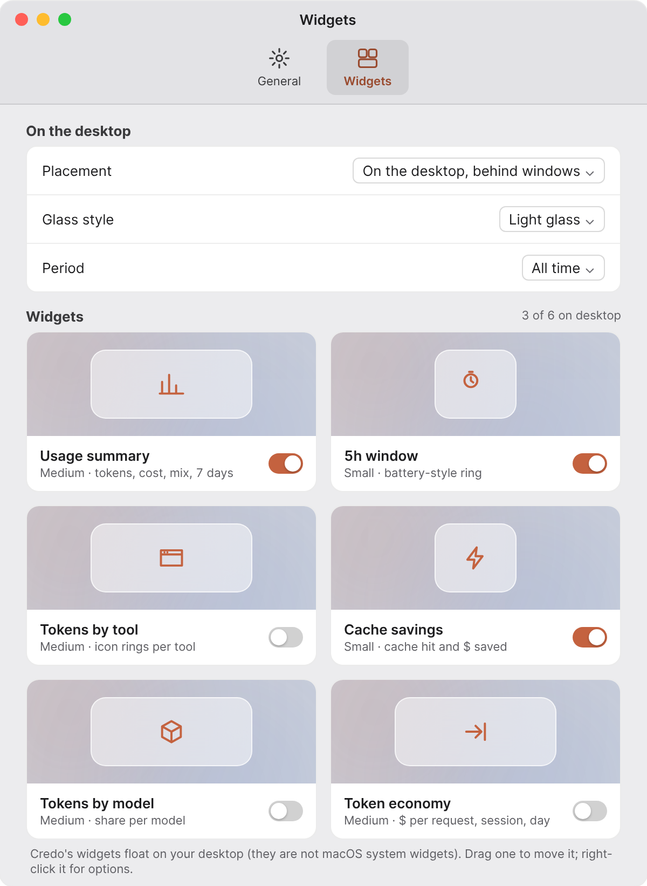

<p align="center">
  
</p>

<h1 align="center">Credo</h1>

<p align="center">
  Local-first and private: it reads the logs Claude already writes to your Mac. No API key, no analytics.
</p>

<p align="center">
  <a href="https://github.com/MJ029/credo/releases/latest"></a>
  <a href="https://github.com/MJ029/credo/actions/workflows/ci.yml"></a>
  <a href="https://github.com/MJ029/credo/actions/workflows/dependency-security.yml"></a>
  <a href="LICENSE"></a>
  
  
  <a href="https://github.com/MJ029/credo/stargazers"></a>
</p>

<p align="center">
  <a href="https://github.com/MJ029/credo/releases/latest"><b>Download</b></a> ·
  <a href="#quick-start">Quick start</a> ·
  <a href="#what-is-and-isnt-counted">What is counted</a> ·
  <a href="docs/HOW-IT-COUNTS.md">How Credo counts</a> ·
  <a href="docs/ARCHITECTURE.md">Architecture</a> ·
  <a href="CHANGELOG.md">Changelog</a>
</p>



> Screenshots use illustrative sample data.

## Introduction

If you use Claude Code or Claude Desktop every day, two questions come up fast: *how much am I
using?* and *how close am I to the limit?* Claude's own screens answer them only in part, and
only when you go and look.

Credo is a small macOS menu-bar tool that answers them continuously. It reads the session logs
Claude Code and Claude Desktop already keep on your Mac, counts each API response exactly once,
and shows the totals where you can always see them: a number in the menu bar, a popover with
breakdowns by model, tool and project, and optional desktop widgets. It also prices your usage at
API list rates, so you can see what a Pro or Max plan is worth to you.

**Who it is for:** anyone who runs Claude Code (terminal, VS Code, JetBrains, the Desktop Code
tab) or Claude Desktop agent sessions on a Mac and wants honest numbers.

**What makes it different**

- **Private by design.** Reads local files only. By default it makes no network requests and never
  reads prompt or response text, only token counts and labels.
- **Counts correctly.** Claude Code repeats a response's token count on every log line, so
  summing lines inflates usage two to four times. Credo de-duplicates by message ID. See
  [How Credo counts](docs/HOW-IT-COUNTS.md).
- **Explicit about its limits.** The [What is and isn't counted](#what-is-and-isnt-counted)
  section lists every token type it captures and every case it does not, with examples.
- **Nothing to configure.** Install it and it finds your logs. Add folders or a token budget only
  if you want to.
- **Built to be audited.** Pure Swift, no third-party dependencies, about 4,000 lines, and every
  change passes a security pipeline before it can reach `master`.

## At a glance

| | |
|---|---|
| **What it is** | A macOS menu-bar app plus six desktop widgets for Claude token usage |
| **Reads** | Claude Code and Claude Desktop JSONL session logs, plus any log folder you add |
| **Shows** | Tokens (input, output, cache write, cache read), API-price cost, cache savings, requests, sessions, 5-hour window, daily chart, model / tool / project breakdowns |
| **Needs** | macOS 13 Ventura or later, Apple silicon. No API key, no account |
| **Network** | None by default. Optional **Sync with Claude account** calls `api.anthropic.com` every 3 minutes |
| **Stack** | Swift 5 / SwiftUI / AppKit, Swift Package, built with the Command Line Tools (no full Xcode) |
| **Dependencies** | None |
| **License** | [MIT](LICENSE) |

**Repository snapshot** (v2.2.3, October 2026; the badges above are live)

| | |
|---|---|
| Languages | Swift 85%, Python 9%, Shell 5%, HTML 1% |
| Source size | about 3,900 lines of Swift in two targets (`TokenCore`, `Credo`) |
| Releases | Installers (`.pkg`, `.dmg`) with `SHA256SUMS.txt` and signed build provenance, published after owner approval |
| Quality gates | 7 CI checks plus 2 dependency checks, all required on every pull request into `master` |
| Branch policy | Pull requests only, no force pushes, status checks must pass, conversations resolved |
| Security | Secret scanning with push protection, Dependabot alerts and updates, pinned and checksum-verified CI tooling |

## Quick start

1. **Download** `Credo-x.y.z.pkg` from the [latest release](https://github.com/MJ029/credo/releases/latest).
2. **Right-click it → Open**, then click **Open** again (Credo isn't signed with an Apple Developer
   ID yet, so macOS asks once).
3. **Finish the installer.** Credo lands in `/Applications` and its number appears in the menu bar.

Click the menu bar number to open the popover. Everything else is optional: widgets, a token
budget and **Sync with Claude account** live in **Settings**. Full steps, building from source
and uninstalling are below.

**Contents:**
[What it does](#what-it-does) ·
[Install](#install) ·
[Command line](#command-line) ·
[Tour](#tour) ·
[Where the numbers come from](#where-the-numbers-come-from) ·
[What is and isn't counted](#what-is-and-isnt-counted) ·
[Privacy](#privacy) ·
[Uninstall](#uninstall) ·
[Contributing and CI](#contributing-and-ci) ·
[Releasing](#releasing) ·
[Documentation](#documentation)

## What it does

Credo reads the session logs that Claude Code and Claude Desktop already write to your Mac and
turns them into a live view of your token usage: how much, on which models, in which tools and
projects, and what it would cost at API prices. It needs no API key, and by default makes no
network requests. Turn on **Sync with Claude account** to match Claude's own 5-hour and weekly limits.

- **Menu bar item.** Text only, no icon. Choose any time window (5 hr, Day, Week, All) and show
  usage, usage + percentage, percentage, or usage + percentage + time left.
- **Popover.** 5 hr / Today / 7D / 30D / All, by provider and by tool (All tools, CLI, Desktop), with totals, the
  input/output/cache split, the current 5-hour window, a daily chart, and breakdowns by model,
  tool and project.
- **Desktop widgets.** Six glass panels you can place anywhere: usage summary, 5-hour window,
  tokens by tool, cache savings, tokens by model and token economy.
- **Sync with Claude account (optional).** Shows Claude's real session %, reset time and weekly
  limit, and lines Credo's 5-hour window up with Claude's.
- **Clean install.** The installer can remove earlier versions first, erase saved data, or
  uninstall only. Credo also offers to move old copies to the Trash when it starts.
- **Accurate counting.** One record per API response, de-duplicated by message ID, with its own
  history so totals survive Claude Code's automatic transcript cleanup.

## Install

### Download (recommended)

1. Download **Credo-x.y.z.pkg** (or the **.dmg**) from the [latest release](../../releases/latest).
2. **Right-click the file → Open**, then click **Open** again.
   Credo isn't signed with an Apple Developer ID yet, so macOS asks once before opening it.
   If you double-clicked and macOS blocked it, go to **System Settings → Privacy & Security** and
   click **Open Anyway**.
3. Follow the installer. On the **Installation Type** step, choose:
   - **Remove previous versions first** (on by default): removes older Credo or TokenMeter apps.
   - **Also erase saved history and settings** (off by default): start completely fresh.
   - **Install Credo** (on by default): untick it, with the first option ticked, to uninstall only.

   Credo installs to `/Applications` and starts in the menu bar. If it finds old copies somewhere
   else when it starts, it asks before moving them to the Trash.

Requires macOS 13 Ventura or later on Apple silicon.

### Build from source

You need Apple's Command Line Tools (`xcode-select --install`). Full Xcode is not required.

```bash
git clone <this repository> credo
cd credo
./build.sh
```

`build.sh` compiles the app, signs it ad hoc for your Mac and writes `Credo-<version>.pkg` and
`Credo-<version>.dmg` next to the script, then opens the installer. In Finder you can
double-click **Install Credo.command** instead; it does the same and saves `build-log.txt`.

Quick check without installing:

```bash
build/root/Applications/Credo.app/Contents/MacOS/Credo --report
```

## Command line

The app binary doubles as a small command-line tool, handy for scripts and for checking a
build without opening the interface:

```bash
/Applications/Credo.app/Contents/MacOS/Credo --report   # print a text summary of your usage and exit
/Applications/Credo.app/Contents/MacOS/Credo --limits   # ask Claude for your plan limits once (tests Sync)
```

`--report` reads the same logs and history as the app. `--limits` needs Claude Code to be signed
in and prints the 5-hour and weekly figures, or the reason Sync can't work.

## Tour

### Popover



Click the menu bar item to open it. At the top, pick a period (5 hr, Today, 7D, 30D, All), a
provider (All, Anthropic, OpenAI, Google) and a tool group (All tools, CLI, Desktop). Credo reads
Claude logs today; OpenAI and Google tools are planned.

| Section | What it shows |
|---|---|
| Totals | Tokens, API-price cost estimate, requests, sessions, cache-hit rate, active days |
| Token mix | Input, output, cache write and cache read, with their shares |
| Current 5-hour window | Time elapsed, tokens, cost, burn rate, start time, time until reset, and tokens against your budget if you set one |
| Tokens per day | Stacked bars per hour (5 hr, Today), day (7D/30D) or week (long All-time ranges) |
| By model / By tool / Top projects | Tokens and cost for each, largest first |

### Menu bar



In **Settings → General → Menu bar shows**, pick a **time window** and what to **show**:

| | Usage | Usage + % | % | Usage + % + time |
|---|---|---|---|---|
| **5 hr** | `42.3M` | `42.3M · 72%` | `72%` | `42.3M · 72% · 1h 24m left` |
| **Day** | `96.4M` | `96.4M · 48%` | `48%` | (5 hr only) |
| **Week** | `512M` | `512M · 64%` | `64%` | (5 hr only) |
| **All** | `1.84B` | `1.84B · 37%` | `37%` | (5 hr only) |

For the 5-hour window, 100% means the window has fully elapsed, or you can set a token budget.
For Day, Week and All, 100% is a token budget you set (for example your weekly allowance).
**Usage + % + time** is offered for the 5-hour window only, and counts down to its reset.
With **Sync with Claude account** on, the 5 hr and Week percentages are Claude's own
(5-hour session and weekly limit), and the time left is Claude's reset time.

### Desktop widgets



Turn widgets on in **Settings → Widgets**. Each one is its own floating glass panel:

- **Drag** a widget anywhere to move it. Credo remembers where you put it.
- **Right-click** (or Control-click) a widget to refresh it, change its period, open settings or
  hide it.
- Choose whether widgets sit **on the desktop behind windows** or **float above everything**, and
  pick **light glass, dark glass or match system**.

| Widget | Size | Shows |
|---|---|---|
| Usage summary | Medium | Tokens, cost, token mix, last 7 days, top tools, 5-hour window |
| 5h window | Small | Battery-style ring with percentage used and time until reset |
| Tokens by tool | Medium | Icon rings with each tool's share |
| Cache savings | Small | Cache-hit ring and the dollars prompt caching saved |
| Tokens by model | Medium | Rings for the top models and the rest |
| Token economy | Medium | Cost per request, per session, per active day; tokens per request |

> Credo's widgets are not macOS system widgets, so they don't appear in **Edit Widgets**.
> System widgets have to be built with WidgetKit and full Xcode. Credo's panels keep the build
> simple and can update every few seconds.

### Settings

<p>
  
  
</p>

- **General:** launch at login, refresh interval, Sync with Claude account, menu bar display
  (changes show in the menu bar immediately), data sources grouped by
  provider (Anthropic, OpenAI, Google; add your own log folders), pricing, and history.
- **Widgets:** placement, glass style, the period widgets cover, and an on/off switch for each widget.

## Where the numbers come from

| Tool | Logs read |
|---|---|
| Claude Code (terminal, VS Code, Desktop Code tab) | `~/.claude/projects/**/*.jsonl`, `~/.config/claude/projects`, `$CLAUDE_CONFIG_DIR/projects` |
| Claude Desktop agent sessions | `~/Library/Application Support/Claude/**/*.jsonl` (caches skipped) |
| Anything else | Folders you add in Settings → General → Data sources |
| OpenAI Codex CLI (planned) | `~/.codex/sessions`, detected and shown in Settings but not counted yet |
| Google Gemini CLI (planned) | `~/.gemini`, detected and shown in Settings but not counted yet |

Regular chats in Claude Desktop run on Anthropic's servers and don't write per-message token
counts to disk, so Credo can't count them.

**Why does Claude Code's built-in Stats panel show about twice as much?** Claude Code writes one
log line per part of a response (thinking, text, each tool call), and every line repeats the
whole response's token count. Adding up lines counts most responses two to four times. Credo
counts each response once by its message ID, which matches how usage is billed. See
[How Credo counts](docs/HOW-IT-COUNTS.md) for details and a script that shows both totals.

**Why doesn't Credo's 5-hour % match Claude's "Current session" bar?** Claude's bar is the share
of your plan's limit used across everything (web, desktop and mobile chats, and Claude Code), and
it's tracked on Anthropic's servers. Without sync, Credo shows how much of the window's time has
elapsed, from local logs, or tokens against a budget you set, and its window can start later than
Claude's if you began with a chat. Turn on **Sync with Claude account** to show Claude's own
figures. See [the full comparison](docs/HOW-IT-COUNTS.md#why-claudes-own-5-hour--differs).

**Costs** use Anthropic's API list prices and are an estimate of value. Pro and Max plans aren't
billed per token. Edit `~/Library/Application Support/Credo/pricing.json` and click
**Reload prices** to change them.

## What is and isn't counted

Credo counts **tokens reported by the Anthropic API in local session logs**, once per API
response. Anything that never reaches a local log, or isn't a token count, is not counted.

### Counted

Every assistant response in a log that carries a `usage` block contributes four numbers:

| Token type | Log field | Shown as |
|---|---|---|
| Fresh input | `input_tokens` | Input |
| Generated output | `output_tokens` | Output |
| Prompt-cache writes | `cache_creation_input_tokens` (5-minute and 1-hour writes are kept apart when the log splits them) | Cache write |
| Prompt-cache reads | `cache_read_input_tokens` | Cache read |

Total tokens = input + output + cache write + cache read.

**Example: one response, counted once.** Claude Code logs this response as three lines (a
thinking block, a text block and a tool call). Each line repeats the same `usage`, so a plain
sum would count it three times. Credo keys on `message.id` and keeps one copy:

```json
{"type":"assistant","entrypoint":"cli","cwd":"/Users/me/shop-api",
 "timestamp":"2026-10-10T14:03:21.512Z",
 "message":{"id":"msg_01ABC","role":"assistant","model":"claude-sonnet-4-5-20250929",
  "usage":{"input_tokens":12,"output_tokens":480,
           "cache_creation_input_tokens":2000,"cache_read_input_tokens":18000}}}
```

| What Credo records | Value |
|---|---|
| Tokens | 12 in + 480 out + 2,000 cache write + 18,000 cache read = **20,492** |
| Tool | Claude Code · Terminal (`entrypoint` is `cli`) |
| Project | `shop-api` (last folder of `cwd`) |
| Model | Sonnet 4.5 |
| Cost at API prices | 12×$3 + 2,000×$3.75 + 18,000×$0.30 + 480×$15, per million = **$0.0201** |
| Cache savings | 18,000 × ($3 − $0.30) per million = **$0.0486** |

Also counted:

- **All Claude Code surfaces**: terminal, VS Code / Cursor / JetBrains, the Claude Desktop Code
  tab and the Agent SDK, each labelled separately.
- **Claude Desktop agent sessions** (`local-agent-mode-sessions`).
- **Any `.jsonl` log folder you add** in Settings → General → Data sources, if it uses the same
  `message.usage` format.
- **Older usage whose transcripts Claude Code has since deleted**, once Credo has read it. Credo
  keeps its own history file (see [Privacy](#privacy)).
- **Responses from models Credo has no price for.** Their tokens are counted. Only the cost
  shows as $0 until you add a price in `pricing.json`.
- **Responses with no timestamp.** They count in totals using the file's modified time, but never
  start or extend the 5-hour window and aren't saved to the history file.

### Not counted

| Not counted | Example | Why |
|---|---|---|
| Regular chats in the Claude apps | A long conversation on claude.ai, the Claude mobile app or the Chat tab of Claude Desktop | These run on Anthropic's servers and write no per-message token counts to your Mac. |
| Usage on other machines | Claude Code run on a work laptop or in a cloud session | Credo only reads logs on the Mac it runs on. |
| Usage before the logs were read | Transcripts Claude Code deleted before you installed Credo | There is nothing left on disk to read. |
| Duplicate copies of a response | The same `msg_01ABC` logged on 3 lines, or copied into a resumed session | Counted once, by message ID. |
| Session totals | Lines with `"type":"result"` or `"type":"summary"` | They repeat per-response usage and would double count. |
| Placeholder messages | Lines with `"model":"<synthetic>"`, such as messages Claude Code wrote itself | No API call was made. |
| Your own messages | Lines with `"role":"user"` | Only assistant responses carry billed usage. |
| Empty usage | A failed or interrupted request reporting 0 input, output and cache tokens | Nothing to count. |
| Other `usage` fields | Anything besides the four above, for example `server_tool_use` / web-search request counts | Credo reads only the four token fields, so per-use charges are not in its cost estimate. |
| OpenAI and Google tools | Codex CLI (`~/.codex/sessions`), Gemini CLI (`~/.gemini`) | Detected and listed in Settings, but not parsed yet. |
| Cache and app-data folders | `Cache`, `IndexedDB`, `Local Storage`, `logs` and similar folders inside Claude Desktop's data folder | They never hold transcripts, so Credo skips them. |
| Prompt and response text | Your code, questions and Claude's answers | Credo never reads or stores message content, only the numbers and labels above. |
| Plan limits | "I've used 72% of my Max session" | A server-side figure, not a token count. Turn on **Sync with Claude account** to show Claude's own percentage. Credo's token totals still come from local logs. |

**Cost is an estimate.** It uses Anthropic's API list prices on the token counts above. On a Pro
or Max plan you aren't billed per token, so read it as the value of what you used.

## Privacy

- Credo reads files on your Mac and has no analytics. By default it makes no network requests.
- **Sync with Claude account** is off until you turn it on. Then, every 3 minutes, Credo reads
  Claude Code's sign-in from your Keychain (with macOS's own `security` tool) and sends one request
  to `api.anthropic.com` for your plan's limits, the same request Claude Code's `/usage` makes.
  The sign-in is never stored by Credo or sent anywhere else, and Credo never renews it. This
  service is unofficial and may change; if it stops working, Credo falls back to its logs.
- It stores a compact history (timestamps, model, tool, project folder name and token counts,
  never prompt or response text) in `~/Library/Application Support/Credo/history-v2.tsv`.
- Delete that folder, or run `./uninstall.sh --all`, to remove everything.

### Security notes for Sync with Claude account

Sync is optional and off by default. Know what you are trusting before you turn it on:

- **What Credo handles.** Claude Code's sign-in token, a credential for your Claude account.
  The Keychain entry also holds a refresh token. Credo reads the whole entry into memory, uses
  only the access token, and never sends, stores or logs any of it. It overwrites the raw bytes
  after parsing, but Swift strings can't be wiped, so the access token stays in memory until the
  request finishes.
- **Where it goes.** One hardcoded address, `https://api.anthropic.com/api/oauth/usage`, over
  HTTPS, in a session with no cache or cookies. Credo refuses HTTP redirects, so the token can't
  be forwarded to another host. Only the two percentages and reset times in the reply are kept.
- **What it can't protect against.** A tampered Credo build could misuse the token, so download
  releases from this repository's Releases page and check the checksum or build provenance
  (see [Releasing](#releasing)), or build from source. Any program running as you can already read the
  same Keychain item with `security`, so Credo doesn't widen that.
- **It's unofficial.** The usage address is undocumented and Anthropic can change or block it.
  Check Anthropic's current terms for third-party apps that use Claude Code's sign-in before you
  rely on it. Turn Sync off at any time and Credo goes back to its local logs.

## Uninstall

Run the Credo installer, untick **Install Credo** on the Installation Type step, and keep
**Remove previous versions first** ticked (tick **Also erase saved history and settings** to remove
everything). Or from a copy of this repository:

```bash
./uninstall.sh          # removes the app, keeps history
./uninstall.sh --all    # also removes history and settings
```

Or quit Credo from its popover and drag `/Applications/Credo.app` to the Trash.

## Contributing and CI

Every pull request into `master` must pass the **CI gate** status check before it can merge
(`.github/workflows/ci.yml`):

| Check | Tool | Catches |
|---|---|---|
| Build (Swift) | `swift build -c release`, warnings as errors | Compile errors and new compiler warnings |
| Package (installers) | `build.sh --no-open` | A broken installer build, found before release day |
| Code smells | SwiftLint 0.65.1, strict | Force casts and `try!`, long functions and files, complexity, style. Existing findings sit in `.swiftlint.baseline.json`; **new** findings fail |
| Secret scan | gitleaks, full history | Committed tokens, keys and passwords |
| SAST | Semgrep (default, secrets and Swift rule packs) | Insecure code patterns |
| Workflow security | actionlint and zizmor | Script injection, unpinned actions, excessive token permissions |
| Personal data guard | `.github/scripts/check-personal-data.sh` | `/Users/<name>` paths, personal email addresses, commits not made with a GitHub noreply address |

A second workflow, `.github/workflows/dependency-security.yml`, checks third-party libraries and
adds the **Dependency gate** check, also required on every pull request:

| Check | Tool | Catches |
|---|---|---|
| Dependency review | GitHub dependency review, fails on moderate or worse | A PR that adds or bumps a library to a version with a known vulnerability |
| Vulnerability scan | OSV-Scanner, also run weekly | Known CVEs in the libraries already in `Package.resolved`, including ones published after they were added |

Credo has no third-party Swift dependencies today, so these pass trivially; they guard any
package added later. Third-party actions are pinned to commit SHAs and downloaded tools are
checksum-verified; Dependabot proposes updates weekly, waiting 7 days after a release. To lint locally:

```bash
swiftlint lint --strict --baseline .swiftlint.baseline.json
```

Commit with your GitHub noreply address (`git config user.email "<id>+<username>@users.noreply.github.com"`)
so the personal data guard passes and your real email stays out of history.

## Releasing

Releases are built on GitHub's runners, never on a developer's Mac, and nothing is published
until the repository owner approves it.

1. In a pull request, bump `VERSION` in `build.sh` and add a `## x.y.z` section to `CHANGELOG.md`.
2. Merge it. The **Release** workflow sees that `vx.y.z` has no release yet and builds
   `Credo-x.y.z.pkg` and `.dmg`. Merges that don't change `VERSION` do nothing.
3. It then **waits for the owner's approval** in the `release` environment (Actions tab, open the
   run, **Review deployments**).
4. On approval it signs build provenance and creates the tag `vx.y.z` and a GitHub Release with the
   installers, `SHA256SUMS.txt` and the changelog notes.

No tag exists without a release. To check a download: `shasum -a 256 -c SHA256SUMS.txt`, or verify
its provenance with `gh attestation verify Credo-x.y.z.pkg --repo <owner>/credo`.

## Documentation

- [How Credo counts](docs/HOW-IT-COUNTS.md): de-duplication rules, tool labels, cost and cache savings
- [Architecture](docs/ARCHITECTURE.md): how the code is organised and how data flows
- [Changelog](CHANGELOG.md)

## License

[MIT](LICENSE). Credo is an independent project and is not affiliated with Anthropic.
