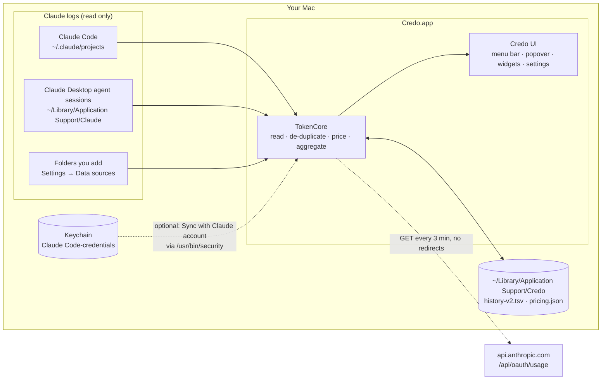
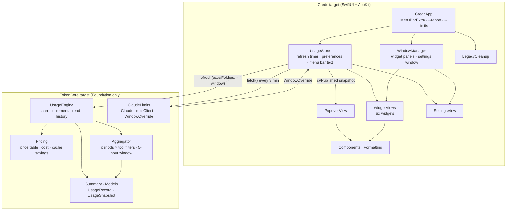
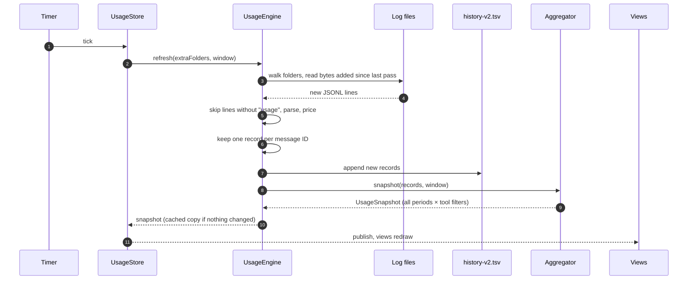
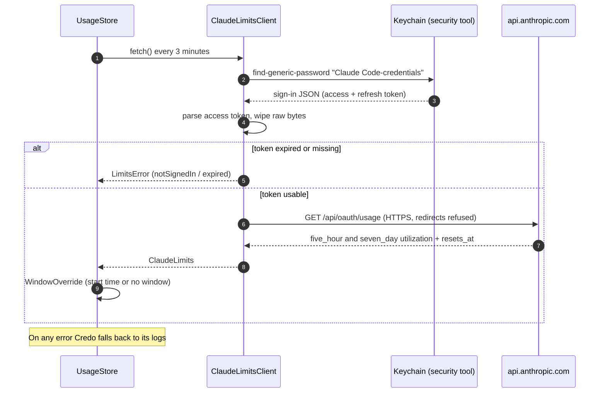

# Architecture

Credo is a Swift Package with two targets and no third-party dependencies.

```
Sources/
  TokenCore/            Foundation only: reading, de-duplication, pricing, aggregation
    UsageEngine.swift   scans log folders, incremental JSONL reader, history file
    Pricing.swift       price table, pricing.json overrides, cost and cache savings
    Aggregator.swift    builds summaries for every period × tool filter, 5-hour window
    Summary.swift       TokenTotals, UsageSummary, SourceFilter, snapshot types
    ClaudeLimits.swift  optional Sync with Claude account: Keychain sign-in, limits request
    Models.swift        UsageRecord, UsageSource (tool labels and icons)
  Credo/                SwiftUI + AppKit app
    CredoApp.swift      MenuBarExtra scene, launch, --report mode
    UsageStore.swift    observable store, refresh timer, preferences, data folder
    PopoverView.swift   menu bar label and the popover
    WidgetViews.swift   the six desktop widgets
    WindowManager.swift widget panels, dragging and right-click menu, settings window
    SettingsView.swift  General and Widgets tabs
    Components.swift    glass card, rings, bars, tachometer logo
    LegacyCleanup.swift offers to move old TokenMeter / duplicate Credo copies to the Trash
    Formatting.swift    number formatting, palette, menu bar text, widget kinds
```

## Diagrams

GitHub draws these from the Mermaid source below each heading.

### System context

What Credo touches. Everything is on your Mac except the one optional request.



### Components

How the two targets fit together. `TokenCore` imports only Foundation and knows nothing about
the UI; `Credo` owns all SwiftUI and AppKit code.



### Refresh cycle

What happens each refresh interval (one minute by default).



### Sync with Claude account (optional)

Off by default. When on, it only decides where the 5-hour window starts and what percentage is
shown; token totals still come from the local logs.



## Data flow

```
JSONL logs ──► UsageEngine ──► [UsageRecord] ──► Aggregator ──► UsageSnapshot ──► UsageStore ──► views
  (local)      incremental      de-duplicated      all periods ×       immutable       @Published
               read + history   by message ID      tool filters
```

1. **Scan.** `UsageEngine.refresh` walks each log folder, skipping Electron cache folders, and
   reads only the bytes added to each file since the last pass. A half-written last line is kept
   until it completes.
2. **Parse.** Lines without `"usage"` are skipped before JSON parsing, which keeps refreshes fast
   on large histories. Matching lines become `UsageRecord`s with cost and cache savings attached.
3. **De-duplicate.** Records are stored in a dictionary keyed by message ID, keeping the most
   complete copy (see [How Credo counts](HOW-IT-COUNTS.md)).
4. **Persist.** New records are appended to `history-v2.tsv` so totals survive transcript cleanup.
5. **Aggregate.** `Aggregator.snapshot` sorts records once, then fills one accumulator per
   (period × tool filter) in a single pass, plus chart buckets and the latest 5-hour window.
6. **Publish.** `UsageStore` runs the engine on a background task every refresh interval (one
   minute by default) and publishes the snapshot. The popover, widgets and menu bar label read
   from it. If nothing changed, the engine returns the cached snapshot.
7. **Menu bar title.** `UsageStore.menuBarText` is recomputed whenever the snapshot changes, any
   setting changes (`UserDefaults.didChangeNotification`) and every 30 seconds, and the
   `MenuBarExtra` label reads it directly, so settings apply without a restart.
8. **Sync (optional).** With Sync with Claude account on, `ClaudeLimitsClient` reads Claude Code's
   sign-in through `/usr/bin/security` and GETs `api.anthropic.com/api/oauth/usage` every 3
   minutes. The reset time becomes a `WindowOverride` passed to `UsageEngine.refresh`, so
   `Aggregator` builds the 5-hour window from Claude's start time instead of from the logs.

## Windows and widgets

- The popover is a `MenuBarExtra` with the `.window` style.
- Each desktop widget is a borderless, non-activating `NSPanel` hosting a SwiftUI view, at desktop
  level (just above the desktop icons) or floating level. Positions are saved per widget with
  frame autosave names.
- Widgets never become the active window, so a transparent `WidgetDragView` on top of each one
  accepts the first click, starts `performDrag(with:)` and shows an AppKit right-click menu.
- Light and dark glass are `NSVisualEffectView` materials with the panel's appearance set to
  aqua, dark aqua or the system default.

## Building without Xcode

`build.sh` uses only the Command Line Tools:

1. `swift build -c release` for the host architecture.
2. Assemble `Credo.app` (binary, `Info.plist` from the template, `iconutil` icon).
3. `codesign --sign -` (ad-hoc signature for local use).
4. Three component packages with `pkgbuild`: the app, plus two script-only steps
   (`Installer/cleanup-scripts`: remove previous versions; `Installer/erase-scripts`: erase saved
   data).
5. `productbuild` with `Installer/distribution.xml`, which shows the three as ticked/unticked
   options on the Installation Type step (`customize="always"`), then `hdiutil` for the `.dmg`.

SwiftUI's `@State` is avoided on purpose. It relies on a compiler plugin that ships with full
Xcode but not the Command Line Tools, so view state lives in small `ObservableObject` classes.

## Continuous integration

`.github/workflows/ci.yml` runs on every pull request into `master` and on pushes to it: build,
SwiftLint, gitleaks, Semgrep, actionlint and zizmor, and a personal data guard. A final **CI gate**
job passes only when all of them pass. `.github/workflows/dependency-security.yml` adds dependency
review and an OSV vulnerability scan behind a **Dependency gate** job. Branch protection requires
both gates. CI runs `build.sh --no-open` as a smoke test on every pull request.
`.github/workflows/release.yml` runs on every push to `master`: if `VERSION` in `build.sh` has no
release yet, it builds the installers on a clean runner, waits for the owner to approve the
`release` environment, then creates the tag and the GitHub Release together.

## Adding another tool

To count another assistant (for example Codex or a Google tool):

1. Add a case to `UsageSource` with its label, short name and SF Symbol.
2. Teach `UsageEngine` where its logs live and how to read their token counts (add a `ScanRoot`
   and, if the format differs, a parser).
3. Add its models to the price table.

The popover, widgets and settings pick up the new source automatically.
